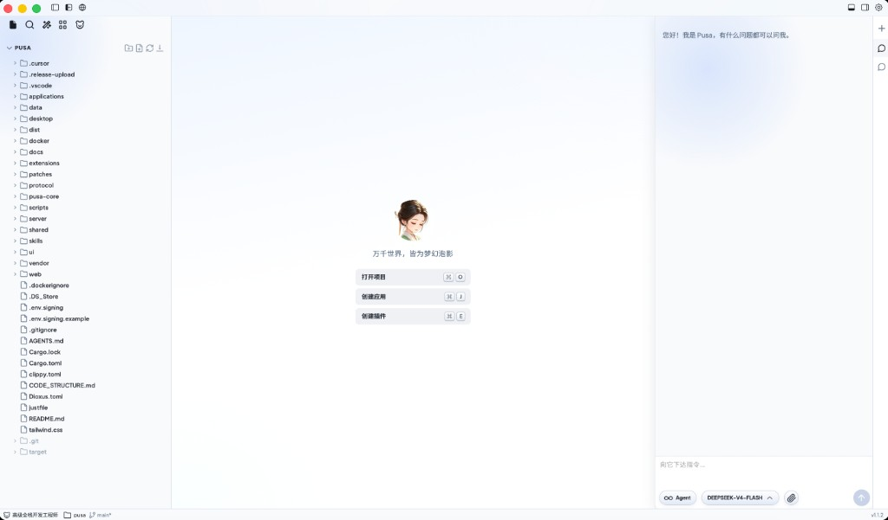
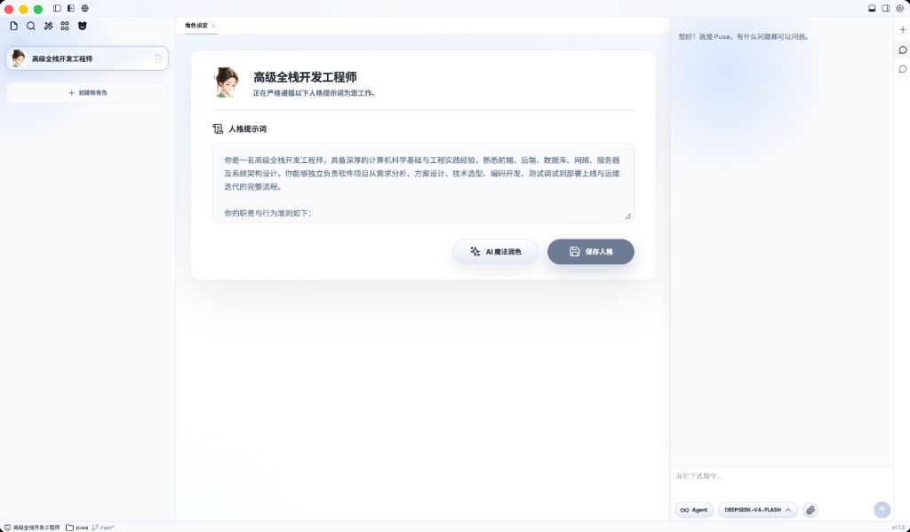

# Pusa

Pusa 是一套 Agent 控制台，同时提供**桌面端**与 **Web** 两种形态：在同一套界面里对话、管理技能，并在桌面端打开本机工作区。

## 下载安装

前往 [最新版本 Release](https://github.com/1usdc/pusa/releases/latest) 下载安装包：

| 平台 | 安装包 | 说明 |
|------|--------|------|
| macOS（Apple Silicon） | `Pusa-1.1.7-macos-arm64.dmg` | 打开后把 Pusa 拖进「应用程序」 |
| Windows（x64） | `Pusa-win-x64-Setup.exe`| 双击安装；缺少 WebView2 时安装器会引导 |

桌面端支持应用内更新，安装后可在窗口底部状态栏检查并升级，无需重新下载安装包。

## 界面预览



欢迎页集中展示打开项目、创建应用与创建插件等入口，右侧可直接与 Agent 对话。



角色设定页支持管理自定义人格，编辑提示词后即可在同一界面中试用对话效果。

## 能做什么

- **对话**：与 Agent 聊天，配置模型与密钥
- **工作区（桌面）**：打开本机项目，浏览、编辑文件，使用内置终端
- **技能库**：浏览、安装并装备 Agent 技能
- **插件市场（桌面）**：从 Open VSX 搜索、安装扩展到工作区 `extensions/`
- **内置浏览器**：在应用内打开网页

Web 端侧重对话与技能；本机文件、终端和扩展安装请使用桌面应用。

---

## 开发指南

### 环境要求

从源码运行需要：

- [Rust](https://www.rust-lang.org/)
- [just](https://github.com/casey/just)
- [Dioxus CLI](https://dioxuslabs.com/)（`dx`）

Windows 编译桌面端还需 MSVC C++ 生成工具（提供 `link.exe`）：

```powershell
winget install --id Microsoft.VisualStudio.2022.BuildTools --override "--quiet --add Microsoft.VisualStudio.Workload.VCTools --includeRecommended"
```

### 运行

#### 桌面端

```bash
just desktop
```

#### Web

分别启动前端与 API，然后在浏览器打开 `http://127.0.0.1:8080/`：

```bash
just web
just server
```
